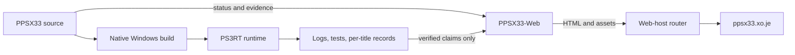
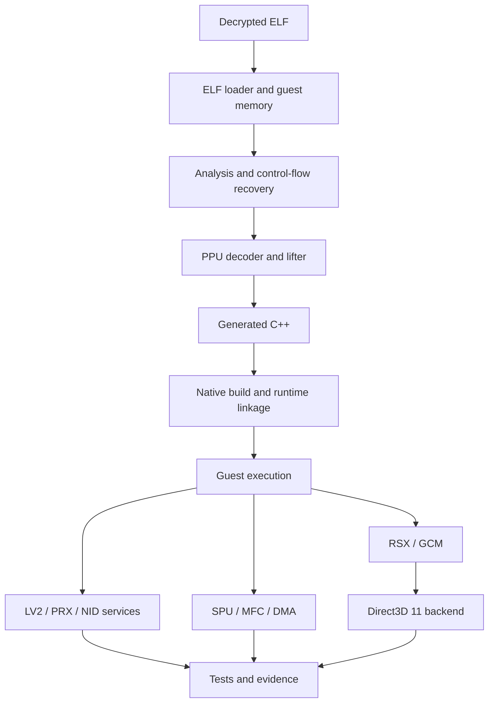
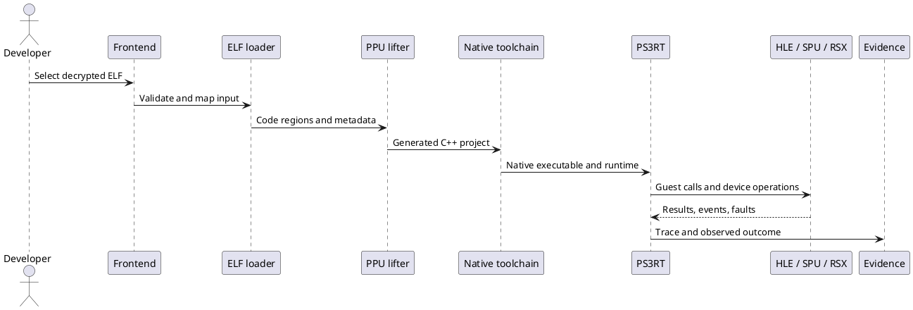
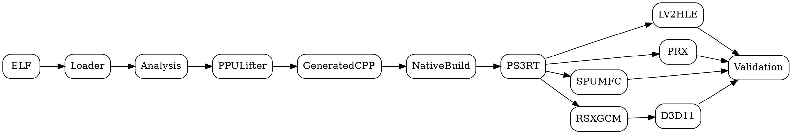

# PPSX33 Architecture

## Repository boundaries

- [PPSX33](https://github.com/NotY215/PPSX33) owns compiler/runtime code, build instructions, implementation status, and compatibility evidence.
- [PPSX33-Web](https://github.com/NotY215/PPSX33-Web) owns public website HTML, shared CSS/JavaScript, assets, and public documentation.
- [Web-host/PPSX33](https://github.com/NotY215/Web-host/tree/main/PPSX33) is the hosting adapter, not the canonical page-content source.

## Recompilation pipeline

## Runtime sequence (PlantUML)

## Dependency graph (Graphviz DOT)

## Correctness boundaries

| Boundary | Required evidence | Invalid inference |
| --- | --- | --- |
| ELF loading | Validated segments, entry point, imports | File opened means all layouts work |
| PPU lifting | Decoder/semantic tests and generated-code checks | Lift count proves semantic correctness |
| Native build | Reproducible build and link results | Compilation proves guest execution |
| HLE/PRX | Module tests and observed call paths | Resolved NID means full API semantics |
| SPU/MFC/DMA | Ordering, tag, atomic and scheduler tests | Stub or assist path is complete |
| RSX/GCM | Title-authored commands and shader output | Diagnostic triangle proves game rendering |
| Compatibility | Repeatable boot and gameplay evidence | Window or one log line proves playability |

Consult the [canonical roadmap](https://github.com/NotY215/PPSX33/blob/main/ROADMAP.md) for the live critical path. PPSX33 accepts decrypted ELF input; input decryption is out of scope.
