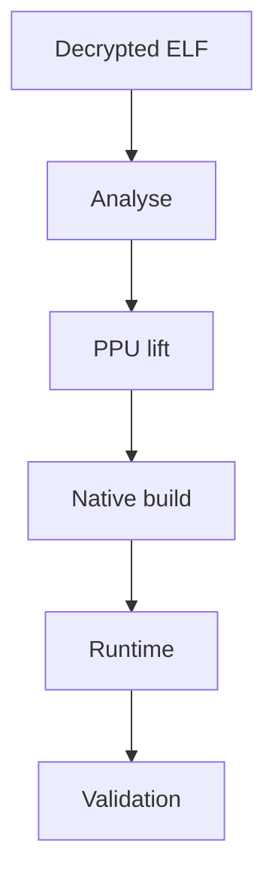
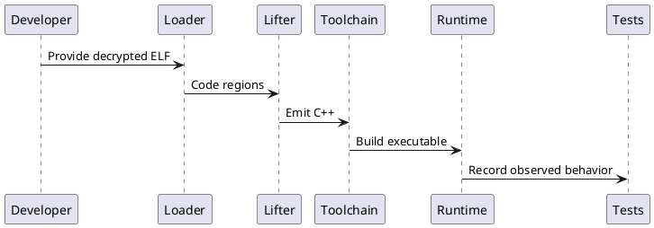
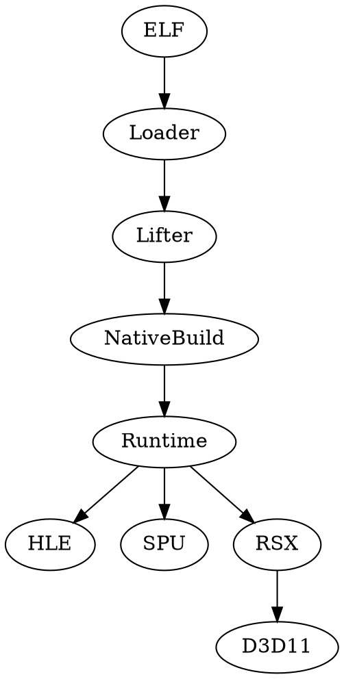

# PPSX33 Website Wiki and Documentation Handbook

## Source of truth

This repository publishes https://ppsx33.xo.je/. The public-facing Documentation page is named the PPSX33 Wiki. The [PPSX33 source repository](https://github.com/NotY215/PPSX33) owns implementation truth. This repository owns website copy, HTML, shared styles, scripts, assets, and diagram source.

## Page map

- `index.html`: project overview.
- `about.html`: purpose and scope.
- `architecture.html`: pipeline and subsystem boundaries.
- `documentation.html`: PPSX33 Wiki and technical reference hub.
- `roadmap.html`: roadmap summary linked to the canonical roadmap.
- `updates.html`: project updates.
- `faq.html`: common questions.
- `developer.html`: developer page.
- `assets/css/style.css`: shared design system.
- `assets/js/app.js`: shared navigation and interactions.

## Diagram standards

Keep source editable, label conceptual diagrams clearly, and do not represent partial work as complete. Mermaid can be rendered by compatible tools such as Beautiful-mermaid; automatic rendering on this website requires explicit integration.

### Mermaid



### PlantUML



### Graphviz DOT



### Markwhen timeline

```text
title PPSX33 milestones
2026-10-29: Website documentation refresh
2026-10-29: Architecture and evidence conventions documented
```

### Scrawl sketches

Use Scrawl sketches as early design artifacts for rough screen flows, data paths, and unresolved questions. Mark each sketch as draft, reviewed, or implemented. Treat sketches as exploration rather than implementation specifications.

## Documentation quality gates

1. Confirm names and statuses against current PPSX33 README and roadmap.
2. Label work implemented, partial, planned, blocked, or untested according to evidence.
3. State environment and flags when claims depend on them.
4. Separate compile success, runtime execution, rendering, bootability, and playability.
5. Link canonical implementation documents instead of copying long tables likely to drift.
6. Keep headings, link text, image alt text, and diagrams accessible on mobile.
7. Check internal routes and external repository links.

## Validation note

For correctness runs, the core project documents `PS3RT_STRICT_FAULT=1`. Assist cmdstreams and diagnostic draws are probes of the host graphics path, not proof of title-authored scene rendering. Consult the [roadmap](https://github.com/NotY215/PPSX33/blob/main/ROADMAP.md) and [developer guide](https://github.com/NotY215/PPSX33/blob/main/docs/DEVELOPER_GUIDE.md).
